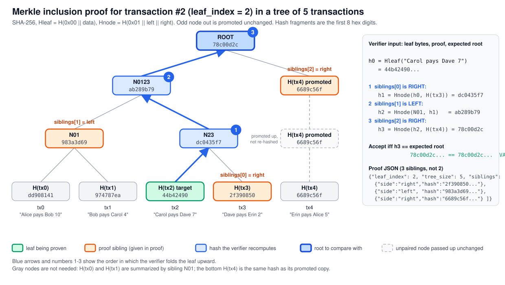

# Assignment 2 – Merkle Trees and Proofs of Inclusion

### Project: MerkleLab

**Student:** Manshi Prajapati  
**Roll Number:** 2302CS08  
**Course:** Blockchain Engineering – Dr. Mayank Agarwal  
**Department:** Computer Science and Engineering, IIT Patna  
**Academic Session:** July–December 2026

**Demo Video:**  https://youtu.be/uI-waxUfPj8
---

## 1. Overview

This assignment focuses on implementing a Merkle Tree library and command-line interface from scratch using Python.

The implementation supports Merkle root calculation, inclusion proof generation, proof verification, and performance benchmarking.

The primary objective is to demonstrate how Merkle Trees provide an efficient and secure way to verify whether a particular transaction or data item belongs to a larger collection without requiring access to the entire dataset.

The implementation uses SHA-256 from Python's standard-library `hashlib` module. No external Merkle Tree package is used.

### Key Features

- Merkle Tree construction from input data.
- SHA-256-based leaf and internal node hashing.
- Domain separation using different prefixes for leaves and internal nodes.
- Merkle root generation.
- Inclusion proof generation for individual leaves.
- Independent proof verification using only the leaf, proof, and expected root.
- Strict proof parsing and validation.
- Handling of odd numbers of leaves through promotion.
- Command-line interface for root, prove, verify, and benchmark operations.
- Performance benchmarking for large datasets.
- Validation against published RFC 6962 Certificate Transparency test roots.

## 2. Technologies Used

| Technology | Purpose |
|---|---|
| Python 3.11+ | Core implementation |
| SHA-256 | Cryptographic hashing |
| `hashlib` | Standard-library hashing implementation |
| Merkle Trees | Data integrity and inclusion proofs |
| pytest | Automated testing |
| JSON | Proof serialization and test vectors |

**Runtime dependencies:** Python standard library only. `pytest` is required for running the tests.

## 3. Project Structure

```text
assign02/
│
├── README.md
├── PERFORMANCE.md
├── requirements.txt
├── pyproject.toml
├── .gitignore
│
├── src/
│   └── merklelab/
│       ├── __init__.py
│       ├── hashing.py
│       ├── tree.py
│       ├── proof.py
│       ├── leafio.py
│       ├── bench.py
│       ├── cli.py
│       └── __main__.py
│
├── tests/
│   ├── test_merklelab.py
│   └── reference_rfc6962.py
│
├── vectors/
│   └── test_vectors.json
│
├── examples/
│   ├── transactions.txt
│   ├── proof_index2.json
│   └── bad_proofs/
│
├── docs/
│   ├── proof_path_5_tx.svg
│   └── proof_path_5_tx.png
│
└── scripts/
    ├── gen_vectors.py
    └── make_diagram.py
```

## 4. Requirements and Setup

### Prerequisites

- Python 3.11 or later.
- pip.

### Windows (PowerShell)

Run the following commands from the `assign02` directory:

```powershell
python -m venv .venv
.venv\Scripts\Activate.ps1
pip install -r requirements.txt
pip install -e .
```

If PowerShell blocks virtual environment activation:

```powershell
Set-ExecutionPolicy -Scope Process -ExecutionPolicy Bypass
.venv\Scripts\Activate.ps1
```

### Linux / macOS

```bash
python3 -m venv .venv
source .venv/bin/activate
pip install -r requirements.txt
pip install -e .
```

The editable installation provides the `merkle` command.

Alternatively, run the package without installing it:

**Linux / macOS:**

```bash
PYTHONPATH=src python3 -m merklelab <command>
```

**Windows PowerShell:**

```powershell
$env:PYTHONPATH="src"
python -m merklelab <command>
```

## 5. Merkle Tree Specification

The implementation follows the Merkle Tree construction defined by RFC 6962 (Certificate Transparency).

| Component | Rule |
|---|---|
| Hash Algorithm | SHA-256 |
| Leaf Hash | `Hleaf(data) = SHA-256(0x00 || data)` |
| Internal Node Hash | `Hnode(left, right) = SHA-256(0x01 || left || right)` |
| Child Size | Both child hashes must be exactly 32 bytes |
| Pairing | Adjacent nodes are paired from left to right, level by level |
| Odd Number of Nodes | The last unpaired node is promoted unchanged to the next level |
| Empty Tree | `SHA-256("")` |
| Single Leaf | `Hleaf(data)` |
| Next-Level Size | `ceil(n / 2)` |
| Proof Order | Siblings are listed from the leaf level upward |

The implementation matches the published Certificate Transparency reference roots for trees containing zero to eight leaves.

### 5.1 Domain Separation

Leaf and internal node hashes use different prefixes:

- `0x00` for leaf nodes.
- `0x01` for internal nodes.

This prevents ambiguity between a leaf and an internal node.

Without domain separation, a 64-byte value formed by concatenating two child hashes could be confused with an internal node's input.

### 5.2 Handling Odd Numbers of Leaves

When a level contains an odd number of nodes, the final unpaired node is promoted unchanged.

It is not duplicated or re-hashed.

This avoids the ambiguity associated with duplicate-last-node constructions, where different leaf lists can produce the same Merkle root.

## 6. Merkle Proof Generation and Verification

A Merkle proof allows a verifier to check whether a particular leaf belongs to a tree without receiving the entire tree.

### Proof Structure

Each proof contains:

- `leaf_index`: Position of the leaf in the original dataset.
- `tree_size`: Total number of leaves.
- `siblings`: List of sibling hashes and their directions.

Example proof format:

```json
{
  "leaf_index": 2,
  "tree_size": 5,
  "siblings": [
    {
      "side": "right",
      "hash": "2f390850473879f7703fb2c95a634ca1ac5ff9334e85793c22a0d366ee1f87a9"
    },
    {
      "side": "left",
      "hash": "983a3d6975e5df6f54cd52814248dbb5d5d2e29b0b83cca6cc703d0e5ecaa6b5"
    },
    {
      "side": "right",
      "hash": "6689c56f30b7d572d08f4b1f7ac0911d9a375f865d93bee06f865bfe7634ebd0"
    }
  ]
}
```

The `side` field indicates where the sibling is located:

- `left`: The sibling is on the left.
- `right`: The sibling is on the right.

For a five-leaf tree, a proof for leaf index 2 requires three siblings.

<caption>Illustration of the inclusion proof path for five transactions.</caption>



### 6.1 Proof Verification

The verification function is:

```python
verify(leaf, proof, expected_root)
```

It uses only three inputs:

1. Original leaf data.
2. Merkle inclusion proof.
3. Expected Merkle root.

The verifier does not need access to the original Merkle Tree.

The verification process:

1. Reads `leaf_index` and `tree_size` from the proof.
2. Recomputes the expected sibling directions.
3. Checks that the number of siblings is exactly correct.
4. Rejects incorrect sibling directions.
5. Rejects out-of-range leaf indices.
6. Reconstructs the root by hashing the leaf with its siblings.
7. Compares the computed root with the expected root.

The verification returns `True` for a valid proof and `False` for a well-formed proof that does not match the expected root. Malformed proofs are rejected with appropriate errors.

## 7. Proof JSON Validation

The implementation performs strict validation of proof JSON.

The following inputs are rejected:

- Invalid JSON.
- Duplicate JSON keys.
- `NaN` values.
- Non-object top-level JSON values.
- Missing or additional fields.
- Invalid `leaf_index` or `tree_size` types.
- Tree sizes less than 1 or greater than \(2^{64}-1\).
- Out-of-range leaf indices.
- Sibling values that are not lists.
- Sibling objects with missing or extra fields.
- Invalid direction values.
- Hashes that do not contain exactly 64 hexadecimal characters.
- Non-hexadecimal characters or incorrectly formatted hashes.

Uppercase hexadecimal input is accepted, but generated proof output always uses lowercase hexadecimal.

## 8. Command-Line Interface

The project provides four main CLI operations:

| Command | Description |
|---|---|
| `merkle root` | Calculates the Merkle root of the input leaves |
| `merkle prove` | Generates an inclusion proof for a selected leaf |
| `merkle verify` | Verifies an inclusion proof against an expected root |
| `merkle bench` | Benchmarks Merkle Tree construction and proof generation |

### Input Format

Leaves are provided through a file, with one leaf per line. A hyphen (`-`) can be used to read from standard input.

The input rules are:

- Each line represents one leaf.
- Raw line bytes are used without Unicode normalization.
- CRLF is treated as LF.
- A final line terminator does not create an additional leaf.
- Blank lines in the middle represent empty leaves.
- An empty file represents zero leaves.
- `--encoding hex` reads each line as hexadecimal bytes.

### 8.1 Calculate the Merkle Root

Example input file: `examples/transactions.txt`

```text
Alice pays Bob 10
Bob pays Carol 4
Carol pays Dave 7
Dave pays Erin 2
Erin pays Alice 5
```

Command:

```bash
merkle root --leaves examples/transactions.txt
```

Example output:

```text
leaves: 5
root: 78c00d2ca02b959884ad83513a0f566abcc72b95f02e5400df4da618ca36d248
```

### 8.2 Generate a Merkle Proof

Generate a proof for the leaf at index 2:

```bash
merkle prove --leaves examples/transactions.txt --index 2 --out examples/proof_index2.json
```

The proof is saved to `examples/proof_index2.json`.

To print the proof directly to standard output:

```bash
merkle prove --leaves examples/transactions.txt --index 2
```

### 8.3 Verify a Merkle Proof

Verify the generated proof:

```bash
merkle verify --root 78c00d2ca02b959884ad83513a0f566abcc72b95f02e5400df4da618ca36d248 --leaf "Carol pays Dave 7" --proof examples/proof_index2.json --tree-size 5
```

Expected result:

```text
VALID: leaf at index 2 is included in a tree of 5 leaves with root 78c00d2c...
```

To demonstrate an invalid proof, change the leaf:

```bash
merkle verify --root 78c00d2ca02b959884ad83513a0f566abcc72b95f02e5400df4da618ca36d248 --leaf "Carol pays Dave 8" --proof examples/proof_index2.json
```

Expected result:

```text
INVALID: proof is well-formed but does not match the expected root
```

### Exit Codes

| Exit Code | Meaning |
|---:|---|
| 0 | Valid proof or successful operation |
| 1 | Invalid proof or input error |
| 2 | Command-line usage error |

### 8.4 Malformed Proof Examples

The project includes malformed proof examples in `examples/bad_proofs/`.

| File | Expected Rejection |
|---|---|
| `malformed_hash_short.json` | Hash must contain exactly 64 hexadecimal characters |
| `malformed_hash_chars.json` | Invalid hexadecimal characters |
| `invalid_direction_value.json` | Direction must be `left` or `right` |
| `wrong_direction.json` | Incorrect sibling direction |
| `index_out_of_range.json` | Leaf index exceeds tree size |
| `wrong_index.json` | Sibling direction does not match the supplied index |
| `too_long.json` | Proof contains more siblings than required |
| `too_short.json` | Proof contains fewer siblings than required |

## 9. Performance Benchmarking

The `merkle bench` command measures construction time and proof size for different dataset sizes.

Run:

```bash
merkle bench --sizes 8,1024,100000 --repeat 5 --markdown
```

### Benchmark Results

The following measurements were obtained on the test machine using pure Python on one core.

| Number of Leaves | Build Time | Siblings | Proof Size (Raw / JSON) |
|---:|---:|---:|---:|
| 8 | 0.01 ms | 3 | 96 B / 316 B |
| 1,024 | 1.04 ms | 10 | 320 B / 956 B |
| 100,000 | 116 ms | 17 | 544 B / 1,595 B |
| 1,000,000 | 1.19 s | 20 | 640 B / 1,869 B |

### Performance Analysis

- Merkle Tree construction requires approximately \(2n-1\) hash calls.
- Tree construction has linear complexity, \(O(n)\).
- Merkle proof generation and verification require logarithmic path sizes, \(O(\log n)\).
- Proof sizes grow logarithmically as the number of leaves increases.

For detailed measurements and methodology, refer to [`PERFORMANCE.md`](PERFORMANCE.md).

## 10. Library Usage

The Merkle Tree library can also be imported and used directly from Python.

```python
from merklelab import MerkleTree, Proof, verify

leaves = [
    b"Alice pays Bob 10",
    b"Bob pays Carol 4",
    b"Carol pays Dave 7"
]

# Construct the Merkle Tree.
tree = MerkleTree(leaves)

# Generate a proof for the third leaf.
proof = tree.prove(2)

# Serialize the proof.
text = proof.to_json()

# Verify the proof without accessing the original tree.
ok = verify(
    leaves[2],
    Proof.from_json(text),
    tree.root
)

print(ok)  # True
```

The library also provides:

- `merkle_root()` for calculating a root directly.
- `Proof` and `Sibling` for representing inclusion proofs.
- `Proof.from_json()` and `Proof.to_json()` for proof serialization.
- `verify()` for independent proof verification.

### Error Handling

The implementation defines the following error types:

| Error | Description |
|---|---|
| `MerkleError` | Base exception for Merkle Tree errors |
| `ProofFormatError` | Raised for malformed proof data |
| `ProofError` | Raised for invalid proof structure, direction, length, index, or size |

These exceptions are subclasses of `MerkleError`.

## 11. Security Considerations and Limitations

### Tree Size Commitment

A Merkle root does not independently commit to the number of leaves.

For example, a proof for index 2 in a five-leaf tree can have the same path shape as a proof for index 2 in a six-leaf tree.

Therefore, the verifier should also validate the expected tree size.

The implementation supports this using:

```bash
--tree-size N
```

This behavior is demonstrated by `test_tree_size_pinning`.

Real-world systems such as Certificate Transparency publish the tree size together with the Merkle root.

### Raw Byte Representation

Leaves are treated as raw bytes. Different byte encodings of the same text can produce different hashes.

Input data should therefore be normalized before constructing the tree when consistent textual representation is required.

### Line-Based Input

A text-mode line cannot represent a literal trailing carriage return independently of CRLF handling. Use `--encoding hex` when exact byte representation is required.

### Hash Visibility

The implementation uses public SHA-256 hashes. The hashes themselves do not require secret information or timing-attack protection.

## 12. Automated Testing and Test Vectors

Run the complete test suite:

```bash
pytest -q
```

**Test Results:**

| Metric | Result |
|---|---:|
| Total Tests | 161 |
| Passed | 161 |
| Failed | 0 |

### Testing Coverage

The automated tests cover:

- Published RFC 6962 Certificate Transparency roots for zero to eight leaves.
- Independent reference implementation comparison.
- Merkle roots for different tree sizes.
- Inclusion proofs for every leaf in trees of sizes 1 to 33.
- Wrong leaf and wrong root rejection.
- Sibling tampering detection.
- Invalid proof directions and indices.
- Proofs that are too long or too short.
- Malformed proof fields and JSON input.
- Domain separation.
- Odd-node promotion instead of duplication.
- CLI commands and exit codes.
- CRLF handling and hexadecimal leaf input.
- Large datasets containing 100,000 leaves.

### Independent Reference Verification

The project includes:

```text
tests/reference_rfc6962.py
```

This is an independent recursive implementation of RFC 6962.

The implementation is used to cross-check Merkle roots and inclusion proofs across multiple tree sizes.

### Test Vectors

The file:

```text
vectors/test_vectors.json
```

contains 15 test-vector sets, including:

- Certificate Transparency reference cases for sizes 0–8.
- The five-transaction example.
- Additional cases for sizes 9, 10, 11, 16, and 17.
- Expected Merkle roots and inclusion proofs.

Regenerate the vectors using:

```bash
python scripts/gen_vectors.py
```

## 13. Deliverables

| Deliverable | Location |
|---|---|
| Merkle Tree library | `src/merklelab/` |
| Hashing implementation | `src/merklelab/hashing.py` |
| Tree construction and root calculation | `src/merklelab/tree.py` |
| Proof generation and verification | `src/merklelab/proof.py` |
| CLI implementation | `src/merklelab/cli.py` |
| Automated tests | `tests/` |
| Independent RFC 6962 reference | `tests/reference_rfc6962.py` |
| Test vectors | `vectors/test_vectors.json` |
| Valid and invalid proof examples | `examples/` |
| Proof-path diagram | `docs/proof_path_5_tx.svg`, `docs/proof_path_5_tx.png` |
| Performance report | `PERFORMANCE.md` |


---

**Course:** Blockchain Engineering  
**Instructor:** Dr. Mayank Agarwal  
**Department:** Computer Science and Engineering  
**Institution:** Indian Institute of Technology Patna  
**Academic Session:** July–December 2026  
**Roll Number:** 2302CS08
