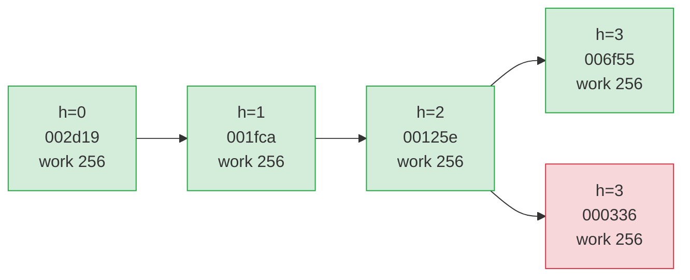
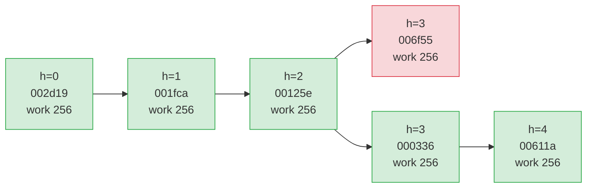

# Assignment 5: Blocks, Proof of Work, Forks and Reorganisation

Generated by `python -m chainlab report` (see README). The traces below are produced by the same code the tests run; block hashes and state hashes are deterministic. Only timings vary by machine.

## 1. Block-header hex dump

A real block from the fork simulation (block **A3**, mined at 8 bits, containing one payment besides the coinbase). The header is a fixed 112-byte structure; the block hash is `SHA-256(SHA-256(header))`, and the Proof of Work is valid when that digest, read as a big-endian 256-bit integer, is at most the `target` field.

```text
field       offset  size  value (hex)
------------------------------------------------------------------------------
version          0     4  00000001   (= 1)
prev_hash        4    32  00125e358e3103d1402146f1202225103cf659612f3d88d47e6a4f0063db2d54
merkle_root     36    32  dcd4e6c044e502e1f442979c21df0cb0023e1b98dc86448215eb05174826bcf8
timestamp       68     8  000000006553f808   (= 1700001800)
target          76    32  00ffffffffffffffffffffffffffffffffffffffffffffffffffffffffffffff
nonce          108     4  00000211   (= 529)

raw header, 112 bytes:
0000  00 00 00 01 00 12 5e 35 8e 31 03 d1 40 21 46 f1
0010  20 22 25 10 3c f6 59 61 2f 3d 88 d4 7e 6a 4f 00
0020  63 db 2d 54 dc d4 e6 c0 44 e5 02 e1 f4 42 97 9c
0030  21 df 0c b0 02 3e 1b 98 dc 86 44 82 15 eb 05 17
0040  48 26 bc f8 00 00 00 00 65 53 f8 08 00 ff ff ff
0050  ff ff ff ff ff ff ff ff ff ff ff ff ff ff ff ff
0060  ff ff ff ff ff ff ff ff ff ff ff ff 00 00 02 11

block hash = SHA-256(SHA-256(header)) = 006f5568c46c41faa1329ee4a32f351d92be094a598a7cd0f050f575175d9135
target                                  = 00ffffffffffffffffffffffffffffffffffffffffffffffffffffffffffffff
hash <= target: True   (hash has 9 leading zero bits; work of this block = 256)
```

Reading the dump: `version` = 1; `prev_hash` points at block 2; `merkle_root` commits to the two transaction ids (coinbase + payment); `target` = `2^248 - 1` (8 leading zero bits, so ~256 attempts on average); `nonce` is the value found by the miner. Changing any single bit of these 112 bytes gives an unrelated hash (avalanche, Assignment 1), which is why a valid nonce cannot be reused after editing the header.

## 2. Diagram of the competing branches

Two miners find a block at height 3 at the same time. `*` marks the active chain of **node A**.

**a) Right after the fork is seen (equal cumulative work, first seen stays active):**

```text
* h=0 002d19b2 [work 256, zero-bits~8, cumulative 256]
`-- * h=1 001fcafe [work 256, zero-bits~8, cumulative 512]
    `-- * h=2 00125e35 [work 256, zero-bits~8, cumulative 768]
        |-- * h=3 006f5568 [work 256, zero-bits~8, cumulative 1024]  <- TIP
        `--   h=3 0003361c [work 256, zero-bits~8, cumulative 1024]
```

**b) After B4 arrives (branch B has more cumulative work, node A reorganises):**

```text
* h=0 002d19b2 [work 256, zero-bits~8, cumulative 256]
`-- * h=1 001fcafe [work 256, zero-bits~8, cumulative 512]
    `-- * h=2 00125e35 [work 256, zero-bits~8, cumulative 768]
        |--   h=3 006f5568 [work 256, zero-bits~8, cumulative 1024]
        `-- * h=3 0003361c [work 256, zero-bits~8, cumulative 1024]
            `-- * h=4 00611a54 [work 256, zero-bits~8, cumulative 1280]  <- TIP
```

Mermaid versions of the same trees (green = active chain, red = stale branch):





## 3. Fork simulation and resolution (task 6)

```text
fork simulation: two nodes, two miners, difficulty 8 bits (~256 attempts/block)
========================================================================

[0. both nodes start from the same genesis]
    genesis 002d19b2

[1. shared history: Alice mines blocks 1 and 2, both nodes accept them]
    block 1: 001fcafe  attempts=46
    block 2: 00125e35  attempts=30
    balances: alice=100 bob=0 miner-a=0 miner-b=0

[2. fork: both miners build on block 2 at the same time]
    Miner A: block A3 006f5568 contains Alice->Bob 30 (fee 1), attempts=530
    Miner B: block B3 0003361c coinbase only,           attempts=64
    node A tip = 006f5568 (A3)   node B tip = 0003361c (B3)
    node A sees: alice=69 bob=30 miner-a=51 miner-b=0
    node B sees: alice=100 bob=0 miner-a=0 miner-b=50

[3. the blocks cross on the network: equal work, first seen stays active]
    node A receives B3 -> side_branch; node B receives A3 -> side_branch
    tips still differ: A=006f5568 B=0003361c (cumulative work 1024 vs 1024)
    node A's block tree:
      * h=0 002d19b2 [work 256, zero-bits~8, cumulative 256]
      `-- * h=1 001fcafe [work 256, zero-bits~8, cumulative 512]
          `-- * h=2 00125e35 [work 256, zero-bits~8, cumulative 768]
              |-- * h=3 006f5568 [work 256, zero-bits~8, cumulative 1024]  <- TIP
              `--   h=3 0003361c [work 256, zero-bits~8, cumulative 1024]

[4. Miner B finds B4 on top of B3 and broadcasts it]
    B4 00611a54 (attempts=158)
    node A receives B4 -> reorganized: fork point 00125e35, disconnected ['006f5568'], connected ['0003361c', '00611a54']
    transactions returned to the mempool: ['61dafeed']
    node A now: alice=100 bob=0 miner-a=0 miner-b=100
    (Bob's payment is gone: its block was orphaned; Alice's coins are spendable again)
    node A's block tree:
      * h=0 002d19b2 [work 256, zero-bits~8, cumulative 256]
      `-- * h=1 001fcafe [work 256, zero-bits~8, cumulative 512]
          `-- * h=2 00125e35 [work 256, zero-bits~8, cumulative 768]
              |--   h=3 006f5568 [work 256, zero-bits~8, cumulative 1024]
              `-- * h=3 0003361c [work 256, zero-bits~8, cumulative 1024]
                  `-- * h=4 00611a54 [work 256, zero-bits~8, cumulative 1280]  <- TIP

[5. the orphaned payment is re-mined on the winning branch]
    B5 0022de68 includes the returned transaction; both nodes accept it
    node A: alice=69 bob=30 miner-a=0 miner-b=151
    node B: alice=69 bob=30 miner-a=0 miner-b=151

converged: same tip 0022de68 and same ledger state hash: True
state hash f277399484aca58447963969ef00cc36b3558a0e3dc7f2d2b7c556903e5c6744
```

What to notice: while the network is split, node A believes Bob was paid 30 and node B believes he was not. Neither block is 'wrong'; there is no single-block finality. B4 gives branch B more cumulative work, so node A disconnects A3 (restoring Alice's spent outputs, removing Bob's), connects B3 and B4, and hands the orphaned payment back so it can be mined again (B5). Both nodes then hold the same tip and the same ledger state hash.

## 4. Most work, not most blocks (acceptance check 1)

```text
work vs length: branch L = 5 blocks at 4 bits (work 16 each, total 80); branch H = 2 blocks at 10 bits (work 1024 each, total 2048)
========================================================================

[node 1 sees H first, then the longer L]
    H block -> extended
    H block -> extended
    L block 1 (height 1) -> side_branch   active tip height 2, work 2064
    L block 2 (height 2) -> side_branch   active tip height 2, work 2064
    L block 3 (height 3) -> side_branch   active tip height 2, work 2064
    L block 4 (height 4) -> side_branch   active tip height 2, work 2064
    L block 5 (height 5) -> side_branch   active tip height 2, work 2064
    result: node 1 stays on H although L is 3 blocks longer

[node 2 sees L first (it is active), then H]
    after L: height 5, work 96
    H block 1 -> reorganized: disconnected 5 L block(s), connected 1 H block(s)   active tip height 1, work 1040
    H block 2 -> extended   active tip height 2, work 2064

both nodes end on the same tip and the same UTXO state: True
```

## 5. Hash rate and expected vs observed attempts (task 7)

Machine: Python 3.13.12 on Windows AMD64.  Raw SHA-256d header hashing: **726,163 hashes/second** (best of 3 runs of 200,000 hashes).

Each target is mined 30 times on different fixed pseudo-headers. At `b` bits one attempt succeeds with probability 2^-b, so attempts are geometrically distributed with mean (and standard deviation) 2^b. The mean of `n` trials therefore has standard error 2^b/sqrt(n); `z` is the distance between observed mean and expectation in those units.

| bits | trials | expected | observed mean | median | min | max | obs/exp | z | time (s) |
|---:|---:|---:|---:|---:|---:|---:|---:|---:|---:|
| 8 | 30 | 256 | 250.2 | 130 | 5 | 2,361 | 0.98 | -0.12 | 0.01 |
| 12 | 30 | 4,096 | 5,667.4 | 4,368 | 324 | 20,330 | 1.38 | +2.10 | 0.28 |
| 16 | 30 | 65,536 | 77,378.6 | 54,588 | 274 | 277,687 | 1.18 | +0.99 | 4.97 |

A single search is very noisy (min and max differ by two orders of magnitude, and the median of a geometric distribution is only about 0.69 x its mean), yet the mean over trials tracks 2^b, with `z` staying within a few standard errors. Each +4 bits multiplies the expected work by 16, which the `expected` and time columns reflect.

## 6. Acceptance checks

| # | check | result | detail |
|---|---|---|---|
| 1 | longer low-work branch loses | PASS | node 1 stayed on the 2-block chain (work 2064); all 5 blocks of the longer branch (work 80) were stored as side branch |
| 2 | high-work branch wins by reorg | PASS | node 2 reorganised from 5 blocks to 2; both nodes share tip and UTXO state: True |
| 3 | Merkle root does not match txs (valid PoW) | PASS | rejected with bad_merkle; active chain and state unchanged: True |
| 4 | a transaction removed after mining | PASS | rejected with bad_merkle; active chain and state unchanged: True |
| 5 | coinbase claims 51 (subsidy 50, no fees) | PASS | rejected with coinbase_excess; active chain and state unchanged: True |
| 6 | coinbase claims subsidy + fee + 1 | PASS | rejected with coinbase_excess; active chain and state unchanged: True |
| 7 | transaction edited after signing | PASS | rejected with invalid_tx/bad_signature; active chain and state unchanged: True |
| 8 | outputs exceed inputs | PASS | rejected with invalid_tx/outputs_exceed_inputs; active chain and state unchanged: True |
| 9 | spends a nonexistent output | PASS | rejected with invalid_tx/input_not_found; active chain and state unchanged: True |
| 10 | double spend inside one block | PASS | rejected with invalid_tx/input_already_spent; active chain and state unchanged: True |
| 11 | valid tx followed by an invalid one: nothing is applied | PASS | rejected with invalid_tx/outputs_exceed_inputs; active chain and state unchanged: True |
| 12 | insufficient proof of work | PASS | rejected with bad_pow; active chain and state unchanged: True |
| 13 | unknown parent | PASS | rejected with unknown_parent; active chain and state unchanged: True |
| 14 | timestamp not after median time past | PASS | rejected with timestamp_too_old; active chain and state unchanged: True |
| 15 | timestamp too far in the future | PASS | rejected with timestamp_too_far_future; active chain and state unchanged: True |
| 16 | second coinbase in a block | PASS | rejected with multiple_coinbase; active chain and state unchanged: True |
| 17 | reorg status | PASS | disconnected 1, connected 2 |
| 18 | UTXO set equals a fresh replay of the winning chain | PASS | state 1df6b9d22968355c... == 1df6b9d22968355c... |
| 19 | conflicting payment resolved | PASS | bob=0, carol=95; the old payment returned to the mempool |
| 20 | branch X1,X2,X3 where X3 is invalid (3 blocks > 2 of work) | PASS | rejected with invalid_tx/outputs_exceed_inputs; active chain and state unchanged: True |
| 21 | rest of the failed branch stays out of the active chain | PASS | active chain is still the original one; the invalid block was forgotten |

**21/21 checks pass.** Every rejection check also proves the active tip and the full ledger state hash are unchanged afterwards.

## 7. Design notes and limitations

* **Chain work** = sum of `floor(2^256 / (target + 1))`. A tie never triggers a reorg, so the first-seen branch stays active.
* **Targets**: a block may use any target not easier than `pow_limit` (a toy simplification of retargeting). Harder targets simply count for more work.
* **Side-branch blocks** are fully validated only when their branch becomes active; until then only PoW, Merkle root, coinbase shape and timestamp are checked. If a branch turns out to contain an invalid block, the reorganisation is rolled back (check 7) and the offending block and its descendants are discarded.
* **Atomicity**: `connect_block` applies transactions one by one but undoes them in reverse if any later rule fails, so a rejected block leaves no trace.
* **Coinbase**: no inputs, memo `coinbase:<height>` (unique txids), value <= subsidy + fees. Unclaimed value is burned; the ledger invariant is `issued == unspent + burned`. There is no coinbase maturity rule (real chains need it because reorgs can orphan coinbases).
* **Not modelled**: networking, a mempool (reorgs return transactions to the caller), difficulty retargeting, SPV proofs. This is a teaching toy, not a cryptocurrency miner.
