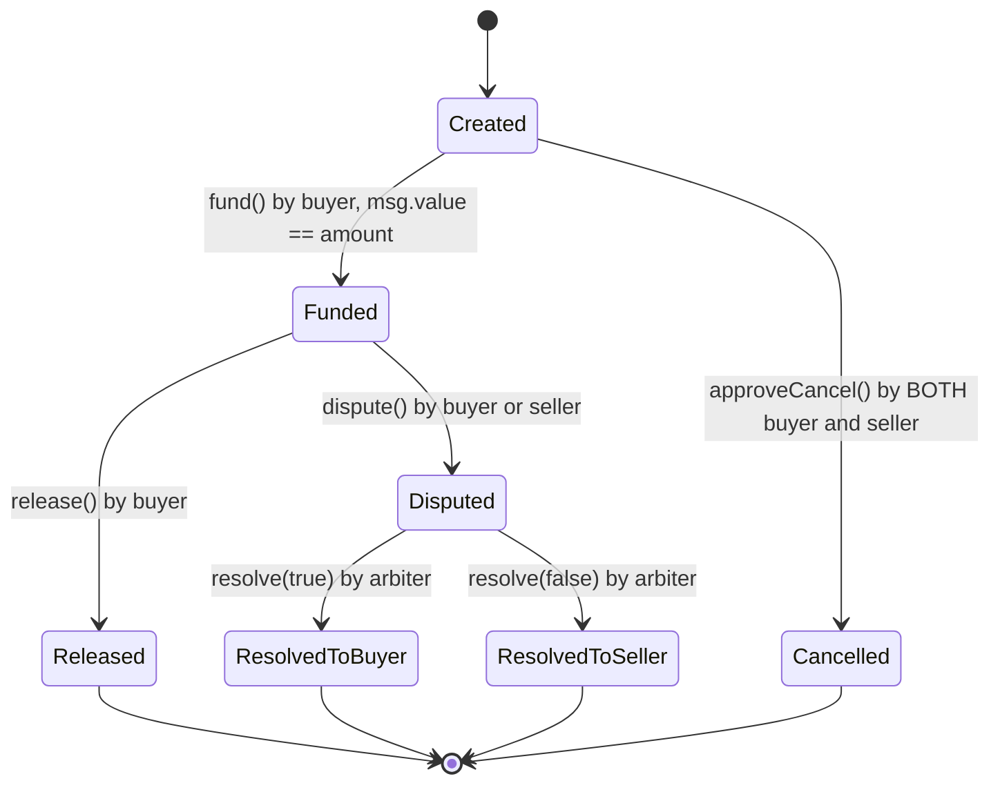

# Escrow specification

**Parties.** `buyer` (deployer), `seller`, `arbiter`. All non-zero and pairwise distinct. `amount` > 0 fixed at deployment.

**State machine** (terminal = no further state change; `withdraw()` only moves credited ETH).

**Payments.** Transitions to Released / Resolved* only record `owed[beneficiary] += amount`. The beneficiary calls `withdraw()` (checks-effects-interactions, `nonReentrant`). Direct ETH transfers revert.

**Invariants.**
1. `address(this).balance >= liabilities()` where `liabilities() = totalOwed + (state in {Funded, Disputed} ? amount : 0)`; equal unless ether is force-sent.
2. `totalOwed == sum(owed)`; credits are created exactly once, in the single transition into a payout state.
3. Cumulative withdrawals never exceed `amount`.
4. Terminal states have no transition functions that succeed.

**Funds-locked analysis.** Created: no funds, exit via fund or mutual cancel. Funded: buyer releases or either party disputes. Disputed: arbiter must resolve (liveness depends on the arbiter; see threat model).
